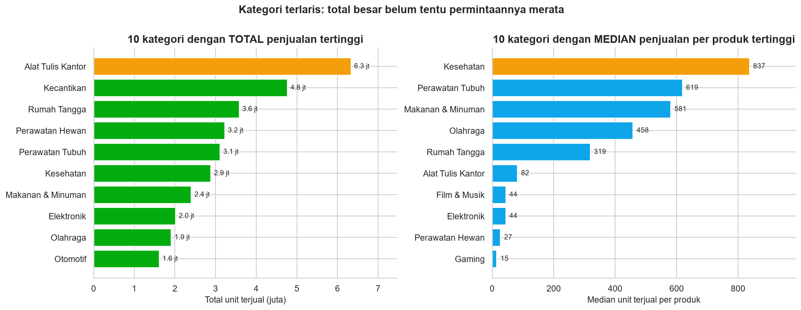
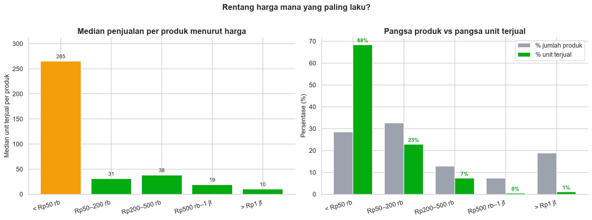
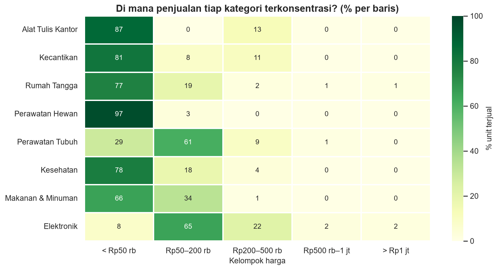
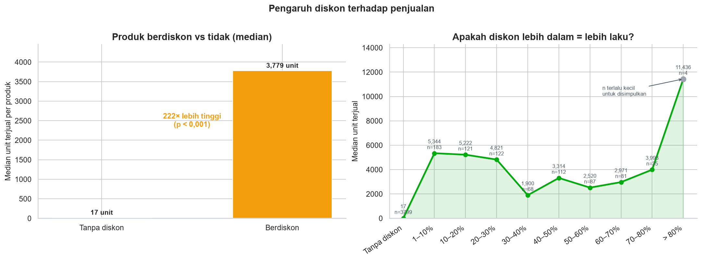
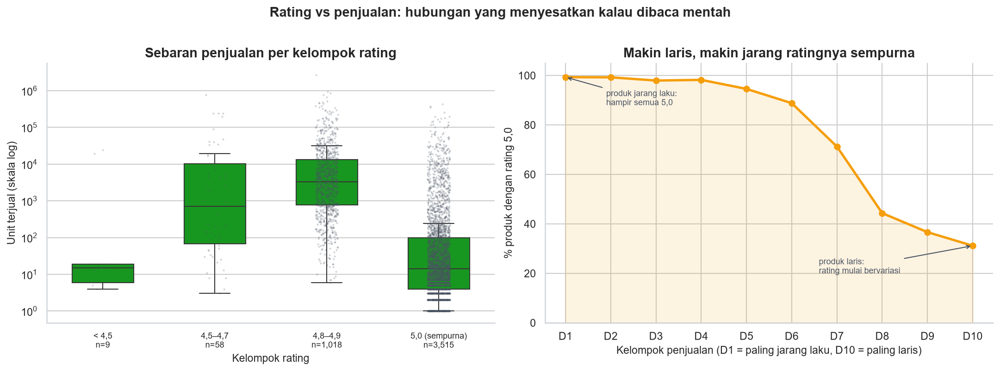
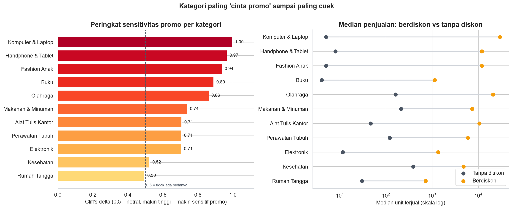
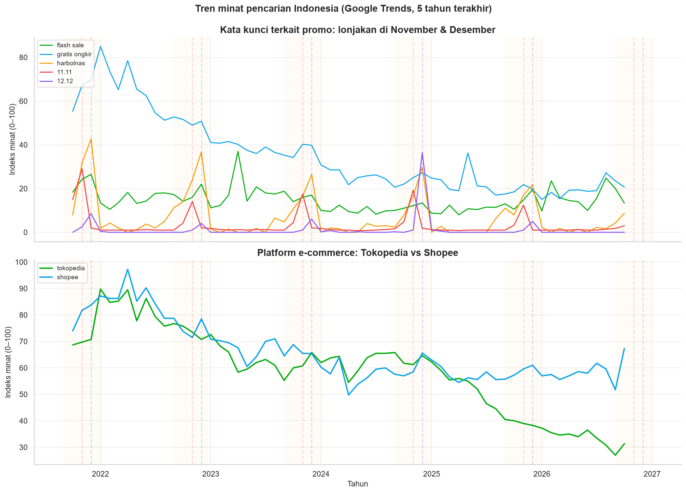

# 🛍️ Analisis Perilaku Belanja Online Orang Indonesia di E-Commerce (Tokopedia)

**Produk Terlaris & Pengaruh Promo** — sebuah analisis data eksploratif dengan Python.


---

## 📌 Latar Belakang

E-commerce sudah jadi bagian sehari-hari orang Indonesia. Setiap Harbolnas, 11.11, dan 12.12,
halaman utama marketplace dipenuhi banner diskon. Tapi pertanyaannya:

> Apakah diskon besar benar-benar membuat produk lebih laku? Kategori apa yang paling
> "cinta promo", dan kategori apa yang pembelinya justru cuek?

Proyek ini menjawab pertanyaan tersebut memakai data produk Tokopedia yang tersedia publik,
dilengkapi data minat pencarian Google Trends untuk melihat pola musiman.

**Untuk siapa analisis ini?** Penjual online dan tim marketing yang ingin tahu di mana
anggaran promo paling efektif dibelanjakan — dan di mana justru sia-sia.

---

## ❓ Pertanyaan Bisnis

| # | Pertanyaan | Jawaban |
|---|---|---|
| 1 | Kategori produk apa yang paling banyak terjual? | Total & median `terjual` per kategori + konsentrasi top-5 |
| 2 | Di rentang harga berapa produk paling laku? | Kelompok harga vs median terjual + heatmap per kategori |
| 3 | Seberapa besar pengaruh diskon terhadap penjualan? (10% vs 50%) | Median per kelompok diskon + korelasi Spearman + uji Mann-Whitney |
| 4 | Seberapa besar pengaruh rating terhadap penjualan? | Scatter/box per kelompok rating + korelasi Spearman + analisis efek plafon |
| 5 | Kategori mana yang paling sensitif terhadap promo? | Cliff's delta per kategori (efek ukuran 0–1) |
| 6 | Bagaimana tren minat saat tanggal kembar & Harbolnas? | Google Trends Indonesia, 5 tahun, 7 kata kunci |

---

## 🗃️ Sumber Data

| Dataset | Isi | Tahun | Lisensi | Link |
|---|---|---|---|---|
| **Tokopedia Product and Review Dataset** | 5.553 produk, 20+ kategori, `count_sold`, `price`, `discounted_price`, `rating_average`, `is_official` | 2025 | CC BY-NC 4.0 | [Kaggle](https://www.kaggle.com/datasets/musabiam/tokopedia-product-and-review-dataset) |
| **Google Trends** (via `pytrends`) | Indeks minat pencarian, `geo='ID'` | 2020–2025 | Syarat layanan Google | [trends.google.com](https://trends.google.com) |

---

## 🧪 Metodologi (ringkas)

1. **Data cleaning** — konversi tipe data, buang duplikat (143 produk ganda), rapikan kategori
   (`kategori|subkategori` → 20 kategori utama), hitung persentase diskon dari harga coret.
2. **Missing value** — 798 produk tanpa `count_sold` **tidak diisi** (mengarang data), hanya
   dikeluarkan dari analisis penjualan. 66 produk tanpa rating dikeluarkan saat analisis rating.
3. **Outlier** — 901 produk (19,5%) di atas batas IQR **tidak dibuang**; pakai median, skala log,
   dan korelasi Spearman yang tahan outlier.
4. **Feature engineering** — kelompok harga (5 bin), kelompok diskon (4 bin), kelompok rating (4 bin).
5. **Analisis** — statistik deskriptif + **median** (bukan rata-rata) + **Spearman** + **Cliff's delta**
   (untuk ukuran efek sensitivitas promo) + **Mann-Whitney / Kruskal-Wallis** (uji signifikansi).

### ⚠️ Batasan yang diakui sejak awal

- **`jumlah terjual` adalah proxy**, bukan laporan penjualan resmi. Tokopedia hanya
  menampilkan angka kasar ("1rb+ terjual").
- **Korelasi ≠ sebab-akibat.** Produk berdiskon yang laku bisa berarti diskon menarik pembeli,
  *atau* penjual mendiskon produk yang memang sudah laku.
- **Snapshot, bukan time series.** Data produk adalah potret satu waktu. Kebutuhan tren ditutup
  dengan Google Trends.
- **Google Trends = minat pencarian (0–100), bukan jumlah pembeli.**
- **Rating mentok di 5,0 (ceiling effect):** 76% produk rating 5,0 → tidak bisa uji pengaruh rating.
- **Cakupan kategori tidak merata:** Dapur 4,9%, Kamera 13% — kesimpulan kategori kecil tidak andal.
- Tidak ada scraping ke Tokopedia; hanya dataset publik dan Google Trends.

---

## 📁 Struktur Repo

```
.
├── notebook/
│   └── Tokopedia_Ecommerce_Analysis.ipynb   # notebook utama (Colab-ready)
├── data/
│   ├── raw/                                 # data mentah (tidak di-commit)
│   └── processed/                           # data bersih hasil cleaning
├── images/                                  # grafik untuk README
├── requirements.txt
└── README.md
```

---

## 📊 Temuan Utama

### Q1. Kategori Produk Terlaris

| Metrik | Juara 1 | Juara 2 | Juara 3 |
|---|---|---|---|
| **Total unit terjual** | Alat Tulis Kantor (6,3 jt) | Kecantikan (4,8 jt) | Rumah Tangga (3,6 jt) |
| **Median per produk** | **Kesehatan (837)** | Perawatan Tubuh (619) | Makanan & Minuman (581) |
| **Konsentrasi (top-5 share)** | Kecantikan **79,5%** | Perawatan Hewan 62,5% | Alat Tulis Kantor 53% |

**Insight:** "Kategori terlaris" tergantung cara mengukur.
- Untuk **belanja iklan massal** → Kesehatan lebih aman (permintaan merata).
- Untuk **strategi "hero product"** → Kecantikan & Perawatan Hewan (satu produk menang, sisanya tidur).



---

### Q2. Rentang Harga Paling Laku

| Rentang harga | Median terjual | Pangsa unit | Pangsa produk |
|---|---|---|---|
| **< Rp50 rb** | **265 unit** | **68,4%** | 28,4% |
| Rp50–200 rb | 31 unit | 22,8% | 32,6% |
| Rp200–500 rb | 38 unit | 7,3% | 12,9% |
| Rp500 rb–1 jt | 19 unit | 0,4% | 7,3% |
| > Rp1 jt | 10 unit | 1,1% | 18,8% |

**Insight:** 7 dari 10 barang yang dibeli di Tokopedia harganya **di bawah Rp50 ribu**.
Barang >Rp500 rb cuma 1,5% dari volume. Promo tidak akan mengubah barang Rp2 juta jadi
laris seperti kaos Rp50 ribu — bedanya frekuensi beli, bukan harga.

**Per kategori beda "zona nyaman"-nya:**
- ATK 87% di <Rp50 rb
- Perawatan Tubuh 61% di Rp50–200 rb
- Elektronik 65% di Rp50–200 rb (di <Rp50 rb cuma aksesori)




---

### Q3. Pengaruh Diskon terhadap Penjualan

| Kelompok | n produk | Median terjual | Rata-rata |
|---|---|---|---|
| **Tanpa diskon** | 3.799 | **17 unit** | 3.559 |
| **Berdiskon** | 813 | **3.779 unit** | 28.158 |
| 1–20% | 304 | 5.298 | 21.397 |
| 21–50% | 302 | 3.296 | 30.282 |
| > 50% | 207 | 3.256 | 34.990 |

- Mann-Whitney p < 0,001 (perbedaan nyata)
- Spearman **rho = 0,50** (hubungan sedang-kuat)

**Tapi — di antara produk yang sama-sama berdiskon:**
- Korelasi diskon% vs terjual: **rho = −0,07** (praktis nol)
- Median **turun** saat diskon makin dalam: 1–10% (5.344) → 20–30% (4.821) → >50% (3.256)

**Kesimpulan:** Yang membedakan laku/tidak adalah **apakah dipromosikan**, bukan **seberapa besar diskonnya**.
Titik manis: **10–30%**. Menambah diskon ke 60% hanya memotong margin tanpa tambah pembeli.



---

### Q4. Pengaruh Rating terhadap Penjualan

| Kelompok rating | n produk | Median terjual |
|---|---|---|
| < 4,5 | 9 | 15 |
| 4,5–4,7 | 58 | 708 |
| 4,8–4,9 | 1.018 | **3.308** |
| **5,0 (sempurna)** | **3.515 (76%)** | **14** |

**Spearman rho = −0,58** (negatif!) → makin tinggi rating, makin *sedikit* terjual.

**Penjelasan (efek plafon / ceiling effect):**
- Produk sepi → sedikit ulasan → semuanya 5,0 → rata-rata 5,0
- Produk laris (27 ribu unit) → ribuan ulasan → mustahil semua 5 → rata-rata turun ke 4,8–4,9

> **Dari data ini TIDAK bisa disimpulkan rating mempengaruhi penjualan.**
> Yang terlihat justru sebaliknya: **penjualan mempengaruhi rating**.
> Untuk penjual: rating 4,8 sudah cukup; mengejar 5,0 sempurna tidak nambah penjualan.



---

### Q5. Kategori Paling Sensitif Promo (Cliff's delta)

Cliff's delta = peluang produk berdiskon lebih laku dari produk tanpa diskon.
0,5 = netral (tidak ada beda). 1,0 = semua berdiskon menang.

| Peringkat | Kategori | Delta | Median berdiskon | Median tanpa | n (diskon/tanpa) |
|---|---|---|---|---|---|
| 1 | **Komputer & Laptop** | **1,00** | 29.359 | 5 | 24 / 235 |
| 2 | **Handphone & Tablet** | 0,97 | 11.928 | 8 | 43 / 251 |
| 3 | **Fashion Anak** | 0,94 | 11.919 | 5 | 20 / 213 |
| 4 | **Buku** | 0,89 | 1.129 | 4 | 32 / 227 |
| 5 | **Olahraga** | 0,86 | 20.823 | 162 | 38 / 192 |
| ... | ... | ... | ... | ... | ... |
| 10 | Kesehatan | 0,52 | 4.777 | 388 | 24 / 138 |
| 11 | **Rumah Tangga** | **0,50** | 717 | 30 | 241 / 233 |

**Insight:**
- **Paling sensitif:** Komputer, HP, Fashion Anak, Buku — di sini diskon hampir selalu menempel
  pada produk unggulan yang sudah laris.
- **Paling cuek:** Rumah Tangga, Kesehatan — barang kebutuhan dibeli apa pun harganya.
- 10 kategori gugur karena sampel diskon < 20 (Kecantikan 17, Otomotif 18, Perawatan Hewan 16).



---

### Q6. Tren Tanggal Kembar & Promo Besar (Google Trends)

**Pola konsisten 5 tahun (2021–2025):**

1. **November (11.11)** → puncak tertinggi "flash sale", "gratis ongkir", "11.11" (3–5× normal)
2. **Desember (12.12)** → puncak kedua, sedikit lebih rendah
3. **September–Desember (Harbolnas)** → mulai naik September, puncak Nov–Des
4. **Tokopedia vs Shopee** → keduanya naik bersamaan saat promo, Shopee lebih tinggi di luar musim



> **Insight praktis:** Mulai persiapan kampanye **September** (asset, stok, budget).
> November–Desember = "zona perang" (CPC mahal, persaingan ketat).
> Januari–Agustus = akuisisi pelanggan murah.

---

## 💡 Rekomendasi Praktis (Untuk Penjual)

1. **Kategori "Hero Product" (Kecantikan, Perawatan Hewan, ATK):** Fokus 1–2 produk unggulan,
   diskon 10–30%, naikkan budget iklan 11.11/12.12. Sisanya harga normal.

2. **Kategori "Merata" (Kesehatan, Makanan & Minuman, Perawatan Tubuh):** Semua produk laku.
   **Jangan pakai diskon besar** — margin terkikis tanpa tambah volume. Pakai bundling / gratis ongkir.

3. **Kategori "Cuek Promo" (Rumah Tangga, Kesehatan):** Diskon tidak signifikan naikkan penjualan.
   Prioritaskan **stok & kecepatan kirim**. Gratis ongkir > potong harga.

4. **Strategi Harga:** >Rp500 rb = volume kecil, margin tinggi. <Rp50 rb = volume besar, margin tipis.
   Jangan harap diskon mengubah barang mahal jadi laris seperti barang murah.

5. **Kalender Promo:** Persiapan **September**. Nov–Des = zona perang. Jan–Ags = akuisisi murah.

---

## 👤 Penulis

**Imanuel R.**
[GitHub](https://github.com/imanuelrpt) · [LinkedIn](https://linkedin.com/in/imanuelrpt)

---

## 📄 Lisensi & Atribusi

Kode di repo ini bebas dipakai untuk pembelajaran (MIT). Dataset tetap milik pemiliknya
masing-masing:
- Tokopedia Product Dataset — CC BY-NC 4.0 (non-komersial, wajib atribusi)
- Google Trends — Syarat layanan Google (riset internal saja)
